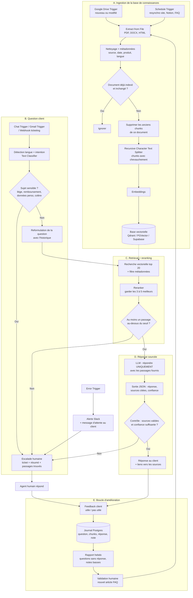

# Support client IA avec base de connaissances RAG (n8n)

## Objectif
Répondre aux questions des clients (chat du site, email, outil de ticketing) à partir **des documents de l'entreprise uniquement** : FAQ, conditions générales, fiches produits, procédures. Chaque réponse cite ses sources. Quand la confiance est trop basse ou que le sujet est sensible, la demande part à un humain. Les retours des clients et des agents servent à améliorer la base en continu.

## Schéma

## Explication étape par étape

**A. Ingestion**
1. **Déclencheurs** : un `Google Drive Trigger` détecte les fichiers ajoutés ou modifiés ; un `Schedule Trigger` resynchronise régulièrement les autres sources (pages du site, Notion, FAQ).
2. **Extraction et nettoyage** : `Extract from File` récupère le texte des PDF, DOCX ou HTML. On retire menus, en-têtes et pieds de page, puis on ajoute des métadonnées (source, date, produit, langue) pour filtrer plus tard.
3. **Indexation incrémentale** : une empreinte du contenu (nœud `Crypto`) indique si le document a changé. S'il a changé, on supprime d'abord ses anciens chunks pour éviter de répondre avec une version périmée.
4. **Chunking** : le `Recursive Character Text Splitter` découpe le texte en morceaux avec un léger chevauchement. La taille des chunks est un paramètre à tester sur vos propres documents.
5. **Embeddings + base vectorielle** : chaque chunk est vectorisé et stocké avec ses métadonnées dans Qdrant, PGVector ou Supabase.

**B. Question client**
6. **Réception** : `Chat Trigger` pour le chat du site, `Gmail Trigger` pour l'email ou `Webhook` depuis l'outil de ticketing.
7. **Tri** : un `Text Classifier` détecte la langue et l'intention. Les sujets sensibles (litige, remboursement, données personnelles, client mécontent) partent directement à un humain.
8. **Reformulation** : la question est réécrite de façon autonome avec l'historique de la conversation (« et pour l'autre modèle ? » devient une question complète).

**C. Retrieval + reranking**
9. **Recherche vectorielle** : on récupère une vingtaine de passages candidats, filtrés par métadonnées (produit, langue).
10. **Reranking** : un reranker (par exemple le nœud `Reranker Cohere`) réordonne ces passages et ne garde que les 3 à 5 plus pertinents.
11. **Seuil de pertinence** : si aucun passage ne dépasse le seuil, on n'essaie pas de répondre : escalade. Le seuil se calibre sur un jeu de questions réelles.

**D. Réponse sourcée**
12. **Génération contrainte** : le LLM reçoit uniquement les passages retenus, avec l'instruction de dire « je ne sais pas » si la réponse n'y figure pas.
13. **Sortie structurée** : JSON avec la réponse, les identifiants des sources citées et un niveau de confiance (`Structured Output Parser`).
14. **Contrôle** : un nœud `Code` vérifie que chaque source citée fait bien partie des passages fournis. Sinon, ou si la confiance est basse, escalade.
15. **Envoi** : la réponse part avec les liens vers les documents sources.

**E. Escalade et amélioration**
16. **Escalade humaine** : ticket créé avec le résumé de la conversation et les passages trouvés, pour que l'agent humain ne reparte pas de zéro.
17. **Feedback** : bouton « utile / pas utile » côté client et note de l'agent humain, enregistrés dans Postgres avec la question, les chunks utilisés et la réponse.
18. **Rapport hebdo** : questions sans réponse et réponses mal notées, regroupées par thème. Un humain valide les nouveaux articles de FAQ, qui sont réinjectés dans l'ingestion.
19. **Gestion d'erreurs** : un `Error Trigger` alerte l'équipe sur Slack et envoie au client un message d'attente avant l'escalade.

## Nœuds n8n principaux
Ingestion : `Google Drive Trigger` / `Schedule Trigger` → `Google Drive` → `Extract from File` → `Crypto` → `Code` → `Default Data Loader` + `Recursive Character Text Splitter` + `Embeddings OpenAI` → `Qdrant Vector Store` (ou `Postgres PGVector Store`, `Supabase Vector Store`).
Question : `Chat Trigger` / `Gmail Trigger` / `Webhook` → `Text Classifier` → `AI Agent` ou `Basic LLM Chain` + `Vector Store Retriever` + `Reranker Cohere` + `Structured Output Parser` + `Postgres Chat Memory` → `IF` → `Respond to Webhook` / `Gmail` → `Zendesk` / `Freshdesk` (escalade) → `Postgres` (journal) ; `Error Trigger` → `Slack`.

## Garde-fous
- **Pas d'invention** : l'IA ne répond qu'à partir des documents fournis et cite ses sources ; sans source fiable, elle passe la main.
- **Validation humaine** : sujets sensibles toujours traités par un humain ; nouveaux contenus de la base validés avant indexation ; au lancement, possibilité de faire relire les réponses avant envoi.
- **RGPD** : ne pas indexer de données personnelles clients dans la base vectorielle ; masquer emails et numéros dans les journaux ; durée de conservation des conversations définie ; mention claire que le client échange avec un assistant IA.
- **Coûts** : indexation incrémentale (on ne revectorise que ce qui change), cache des questions fréquentes, modèle léger pour le tri, limite de tokens par réponse.
- **Sécurité** : documents et questions traités comme des données, pas comme des instructions (injection de prompt) ; filtrage par métadonnées pour qu'un client ne voie jamais un document interne ; clés API dans les credentials n8n, jamais en clair.
